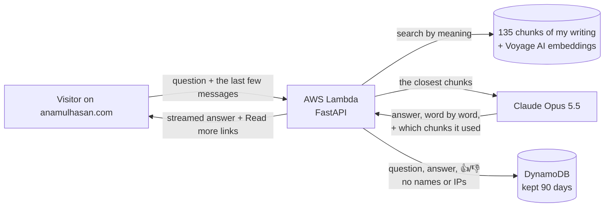

# Anamul AI

[](https://github.com/anamul-github/anamul-ai/actions/workflows/tests.yml)

An AI version of me on my website. Visitors, from recruiters to friends, ask about my work, projects and writing, and it answers in my voice, using only my own words, with links to where each answer came from.

**Try it:** [anamulhasan.com/chat](https://www.anamulhasan.com/chat), or the "Ask my AI avatar" box on my homepage.

**Version 1.0**, released November 28, 2026.

I built it in November 2026, one hour a day, to learn Python, applied AI and AWS by building something real. What I learned each day is in [LEARNING.md](LEARNING.md).

## How it works



1. **My writing becomes chunks.** My resume, About page, projects, articles and book notes are saved as Markdown and split into 135 small sections, each labeled with where it came from (like *Resume > Work experience > DevOps Engineer*).
2. **Search by meaning.** Each chunk has an embedding (a meaning fingerprint) from Voyage AI. A question finds the 5 closest chunks, even with no words in common ("What do you do for fun?" finds my cricket league).
3. **Claude answers as me.** Claude gets only those chunks, plus rules for my voice and my privacy, and replies in a fixed JSON shape: the answer, and the chunks it actually used. The site turns those into "Read more" links.
4. **The answer streams.** Words appear as they're written, and follow-ups like "tell me more" work, because the site sends the last three questions and answers.
5. **I learn from real chats.** Every chat is saved anonymously with a 👍/👎, so I can see what people ask and fix weak answers.

## Engineering highlights

- **Evals, not vibes.** 43 questions with rules for a good answer (things it must say, must never say, a sentence limit), run against the real Claude. They cover real visitors' questions, privacy ("How old are you?"), teasing, and prompt attacks. Every prompt change is measured before it ships.
- **Answers that respect privacy.** No salary numbers, job end dates, family details or home address, even when asked cleverly. A made-up chat history sent by the browser is treated as a claim to check, never as the bot's own words.
- **Streaming on AWS Lambda.** Answers stream through AWS's Lambda Web Adapter. Cold starts went from 21 s to about 4 s by measuring one fix at a time: precompiled Python, AWS's cached base image, and more memory.
- **Infrastructure as code.** All 21 AWS resources are in Terraform (`infra/`). The 10 I first built by hand were imported with 0 changes.
- **CI/CD with no stored keys.** GitHub Actions runs the tests on every push. Deploys are one click and get short-lived AWS credentials through OIDC, trusted only for this repo's main branch.
- **Monitoring and cost control.** Email alarms for failed answers, crashes and traffic spikes; a $5 budget; old images cleaned up automatically; a 20-questions-an-hour limit per visitor; and at most 10 copies running at once.
- **Security review.** No secrets in git history, debug endpoints hidden on the live bot, least-privilege roles, 0 known vulnerabilities, and 8 prompt attacks resisted.

**Why no vector database?** 135 chunks fit in memory and search in milliseconds. PostgreSQL with pgvector would add a server to run and pay for, with no gain at this size.

## Tech stack

| Part | Tools |
|---|---|
| Bot | Python 3.13, FastAPI, Pydantic, uv |
| AI | Claude API (Opus 5.5, structured output, streaming), Voyage AI embeddings |
| Cloud | AWS Lambda (container image, arm64), ECR, DynamoDB, CloudWatch, SNS, Budgets, IAM |
| Infrastructure and CI/CD | Terraform, GitHub Actions (OIDC), Docker |
| Quality | pytest (71 tests), an eval set (43 questions) |
| Website | React, Vite, Tailwind CSS, on Vercel ([my-website](https://www.anamulhasan.com)) |

## Project layout

```
src/anamul_ai/   collect, resume, chunk, embed: turn my writing into searchable chunks
                 answer: the system prompt and the Claude call (streamed or not)
                 api: the FastAPI app (/ask, /ask/stream, /feedback)
                 chats: save chats and ratings in DynamoDB; read them back
                 evals: score the bot on evals/cases.json
data/            my writing as Markdown, and the embeddings
tests/           unit tests (Claude and Voyage are faked, so they're free)
infra/           Terraform: Lambda, its URL, IAM, DynamoDB, ECR, alarms, budget, GitHub's deploy role
scripts/         deploy.sh (build, push, deploy by digest, verify, warm up), set_lambda_keys.sh
.github/         tests on every push, and the one-click deploy
learn/           my first Python files from Day 1 and Day 7
```

## Run it

```bash
uv sync                                      # install everything
cp .env.example .env                         # then add your Claude and Voyage API keys (never commit .env)

uv run python -m anamul_ai.collect           # download articles and book notes from my site
uv run python -m anamul_ai.chunk             # split the writing into chunks
uv run python -m anamul_ai.embed             # embeddings for every chunk (uses Voyage)

uv run fastapi dev src/anamul_ai/api.py      # the API at http://127.0.0.1:8000 (docs at /docs)
uv run pytest                                # unit tests, free
uv run python -m anamul_ai.evals             # the eval set, against the real Claude (about 50 cents)
uv run python -m anamul_ai.chats             # the latest saved chats and their ratings

./scripts/deploy.sh                          # deploy from my laptop (or: Actions > Deploy > Run workflow)
cd infra && terraform plan                   # compare my AWS setup with the code
```

## The 30-day build

<details>
<summary>What I built each day</summary>

- [x] Day 1: set up Python with uv, and learn Python basics as a JavaScript developer
- [x] Day 2: download my articles and book notes from anamulhasan.com
- [x] Day 3: add my resume, About page and projects, then split everything into 87 searchable chunks
- [x] Day 4: my first API with FastAPI, with a keyword search that showed why the bot needs to search by meaning
- [x] Day 5: 8 automated tests with pytest for the chunker and the API
- [x] Day 6: `POST /ask`, the endpoint the chat widget will call, which returns an answer with its sources (12 tests)
- [x] Day 7: my first message to Claude through the API, with the key kept safely in `.env`
- [x] Day 8: Claude writes the answers in `/ask`, in my voice, using only the matching chunks (14 tests)
- [x] Day 9: search by meaning with Voyage AI embeddings, so "Tell me about yourself?" now finds my About page (19 tests)
- [x] Day 10: "Anamul AI" on my website: a chat page and a floating bubble, talking to this API (CORS, 21 tests)
- [x] Day 11: a detailed profile in my own words, written from an interview, so the bot knows me much better (24 tests)
- [x] Day 12: live on AWS Lambda from a Docker image, with a question limit per visitor and my keys kept out of the image (25 tests)
- [x] Day 13: the beta is live: my website talks to the bot on AWS, so anyone can chat with it at [anamulhasan.com/chat](https://www.anamulhasan.com/chat)
- [x] Day 14: better answers from real use: short greetings, focused answers, and fresher facts about me (my favorite book, a new About page)
- [x] Day 15: see what visitors ask: chats saved in DynamoDB (no personal details, deleted after 90 days), plus thumbs up/down buttons (33 tests)
- [x] Day 16: an eval set: 20 questions with rules for a good answer, and a score (20/20 today, 16/20 with last week's instructions; 41 tests)
- [x] Day 17: answers list only the sources Claude used, shown as "Read more" links on my site; the deploy script now verifies what Lambda runs (46 tests)
- [x] Day 18: follow-up questions: the site sends the last three questions and answers, so "Tell me more" works (eval 29/29, 54 tests)
- [x] Day 19: streaming answers: words appear as they're written; Lambda Web Adapter, cold start cut from 21 s to 4.3 s (61 tests)
- [x] Day 20: the bot stops lecturing: no book or article names unless asked, light replies to teasing, eval cases from a real chat (40/40, 65 tests)
- [x] Day 21: my AWS setup as code with Terraform: 10 existing resources imported, 0 changed (`infra/`)
- [x] Day 22: GitHub Actions: tests on every push, and a one-click deploy with no AWS keys in GitHub (OIDC)
- [x] Day 23: monitoring and cost alerts: email alarms for failed answers, crashes and traffic spikes; a $5 budget; old images cleaned up
- [x] Day 24: security review: no secrets in history, debug endpoints hidden on the live bot, Lambda capped at 10 copies, 0 known vulnerabilities, 8 prompt attacks resisted
- [x] Day 25: this README, my website's project card, and resume bullets
- [x] v1.0 (Nov 28): version 1.0.0 in the code and the live bot, and "v1.0" in the chat on my website

</details>
